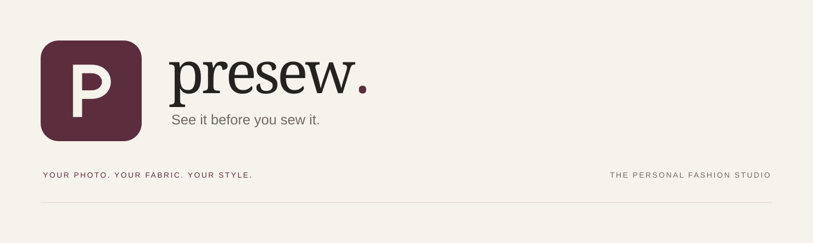
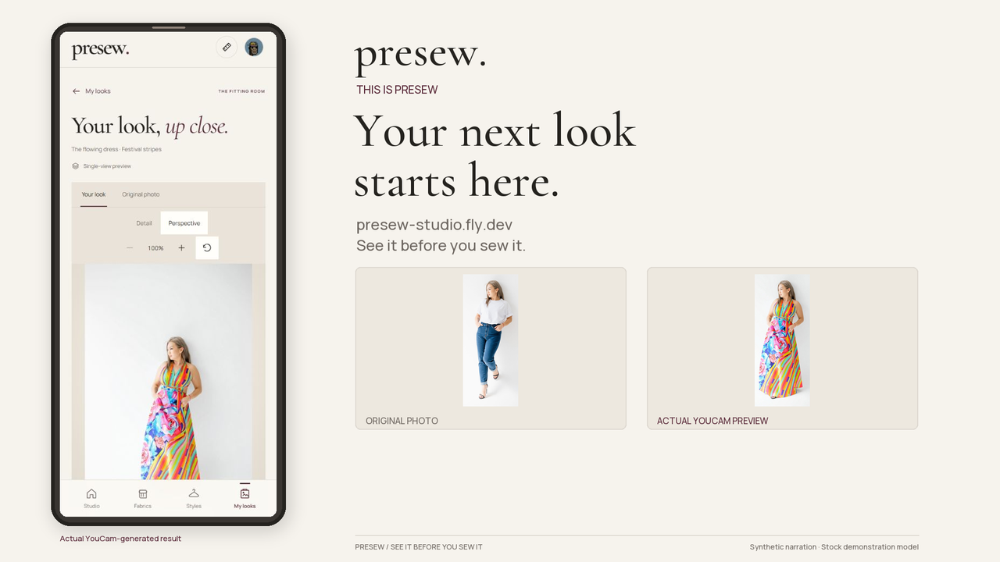
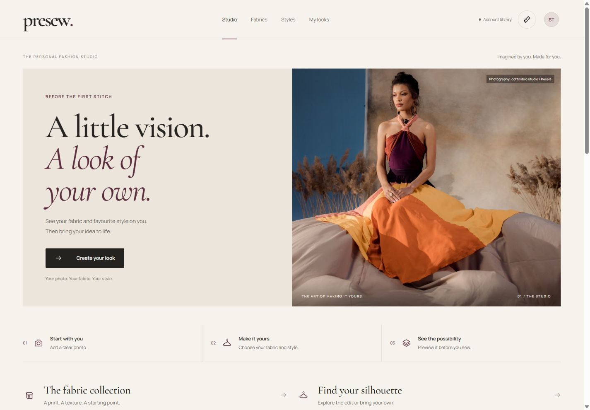
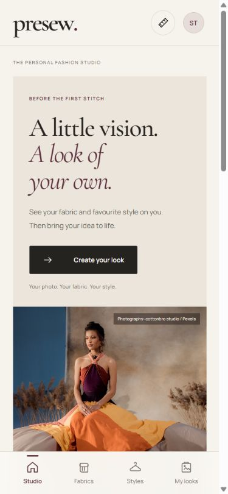
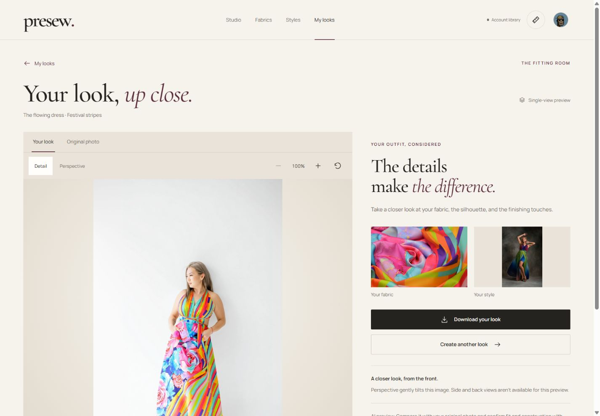
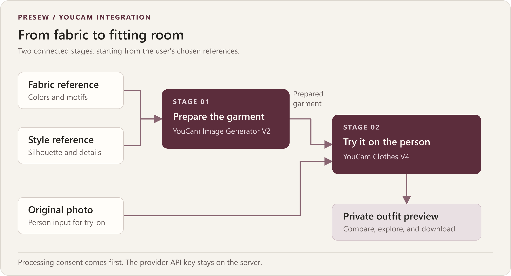
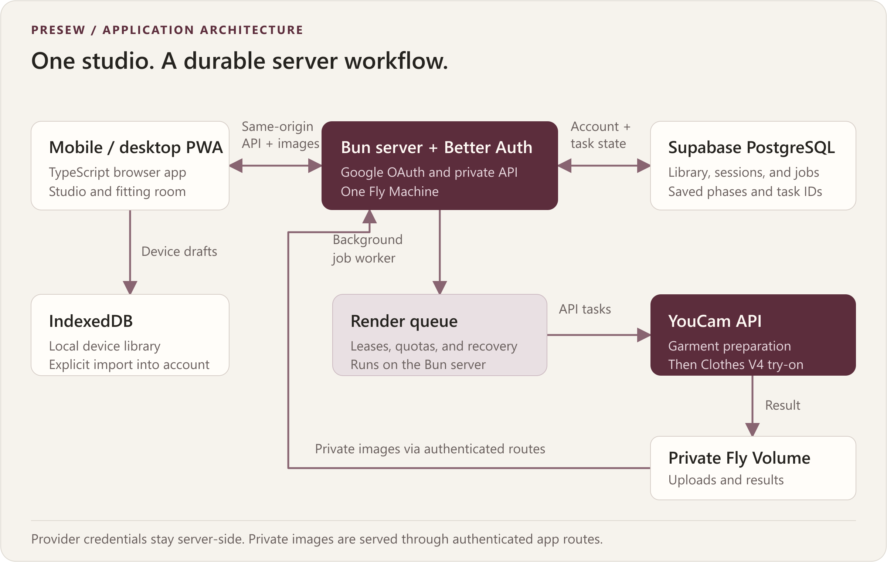
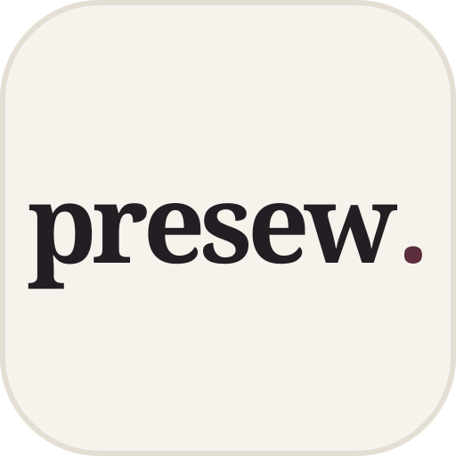

# PreSew

**Your photo. Your fabric. Your style. See it before you sew it.**

PreSew is a mobile-first fashion studio that helps people visualize a custom outfit **before the fabric is cut**. Combine a person photo, a fabric reference, and a style you love; generate a personalized YouCam preview; then keep the references, notes, and optional measurements together for a clearer conversation with your tailor.

**[Open the live app](https://presew-studio.fly.dev/)** · **[Watch the 3-minute YouTube demo](https://youtu.be/g5kmeHbxNL0)** · **[Source code](https://github.com/Haleem-code/presew-studio)** · [MIT license](LICENSE) · [Hackathon](https://youcam-api-skin-ai-ecommerce.devpost.com/)

Built by **Haleem** for the **YouCam API Skin AI & eCommerce VTO Hackathon**. Project direction: **eCommerce VTO / custom fashion**. Runs in mobile and desktop browsers, with PWA installation support.

[](https://youtu.be/g5kmeHbxNL0)

*The demo follows the live Fly.io app, includes English captions, and shows a real two-stage YouCam result. It uses a licensed stock model and clearly labelled sample measurements. Processing waits are shortened in the edit.*

[The problem](#the-problem) · [Try it](#try-presew) · [YouCam integration](#how-youcam-powers-the-preview) · [Hackathon fit](#how-presew-addresses-the-judging-criteria) · [Run locally](#run-locally) · [Deployment](#deployment) · [Privacy and limits](#privacy-and-current-limitations)

## The problem

A custom outfit often starts with three separate things: a photograph of someone else's clothes, a piece of fabric, and a conversation with a tailor. The buyer has to imagine how they will come together. By the time that combination becomes visible, the fabric may already have been bought and cut.

A bold print can read differently on a flowing dress than on a fitted blouse. A style reference alone cannot show the buyer's fabric on their own photo. PreSew brings those decisions into one visual workflow before sewing begins.

The starting point is custom-clothing culture in Nigeria, including **owambe** celebration outfits, with a workflow that can also serve other made-to-order clothing markets.

| Who it serves | Decision PreSew helps them make |
| --- | --- |
| Event attendees and everyday custom-clothing buyers | Explore a fabric-and-style combination on their own photo before committing to it |
| Tailors and fashion designers | Discuss a client's intended look using the same visual references, notes, and manually entered measurements |
| Fabric shoppers | Consider how a fabric might look as a particular garment, beyond a flat swatch |

The intended benefit is less guesswork and clearer communication. Reduced fabric waste, fewer alterations, and commercial conversion improvements are **future validation goals**, not measured outcomes of this prototype.

## What makes the idea different

PreSew starts with a **garment that has not been made yet**. The user independently chooses the fabric and silhouette instead of being limited to a finished garment in a retailer's inventory.

That creates a concrete role for two YouCam capabilities: first prepare a garment reference from the fabric and style, then apply that prepared reference to the original person photo. The surrounding product carries the decision through selection, consent, saved progress, comparison, and an exportable outfit plan.

## Try PreSew

Open **[presew-studio.fly.dev](https://presew-studio.fly.dev/)**. Google sign-in is required to create a try-on and save an account library. Reviewers do not need to enter a YouCam key; provider credentials stay on the server.

1. **Start a look and sign in with Google.** Upload a clear JPG or PNG under 10 MB, showing one person and the full outfit area. Use your own image or one you have permission to process.
2. **Choose a fabric.** Upload a flat, well-lit fabric photo or select **Festival stripes** to follow the demo.
3. **Choose a style.** Upload a photograph of a finished outfit or select **The flowing dress**. Continue to **Review your look**.
4. **Add optional measurements before generating.** Choose **Manage measurement profiles → Add measurement profile**, enter values in centimeters or inches, save the profile, and select it in the review screen's **Measurements** dropdown. Notes can capture preferences such as a longer hem. Measurements support the outfit plan; they do not control the AI image.
5. **Review and consent.** Check all three references, accept image-processing consent, and select **Try it on**. Progress is saved on the server; return through **My looks** if you leave the screen. Generation uses provider units and may take time.
6. **Inspect and keep the idea.** Open the completed fitting room, switch between the original and result, zoom and pan, and download the image. Separately, choose **Save outfit plan** on Review; open it under **My looks → Outfit plans** and use **Download plan** to export the references, notes, and attached measurements.

To reproduce the video's inputs without a personal photo, use the [credited stock-model source](https://www.pexels.com/photo/woman-posing-on-white-background-17781161/) and the two presets above. The source photograph is licensed, not public domain. [Demo media and permissions](docs/DEMO_MEDIA.md) lists the credits and terms.

### Demo chapters

| Time | What to look for |
| --- | --- |
| [00:00](https://youtu.be/g5kmeHbxNL0?t=0) | The problem and PreSew's purpose |
| [00:24](https://youtu.be/g5kmeHbxNL0?t=24) | Start a look in the mobile interface |
| [00:34](https://youtu.be/g5kmeHbxNL0?t=34) | Upload the person photo |
| [00:49](https://youtu.be/g5kmeHbxNL0?t=49) | Select the fabric |
| [01:05](https://youtu.be/g5kmeHbxNL0?t=65) | Select the style |
| [01:21](https://youtu.be/g5kmeHbxNL0?t=81) | Enter optional measurements |
| [01:39](https://youtu.be/g5kmeHbxNL0?t=99) | Review the combination and consent |
| [01:57](https://youtu.be/g5kmeHbxNL0?t=117) | Understand the two YouCam stages |
| [02:15](https://youtu.be/g5kmeHbxNL0?t=135) | Compare and explore the actual result |
| [02:35](https://youtu.be/g5kmeHbxNL0?t=155) | Reopen and download the outfit plan |

[Detailed demo script](docs/DEMO_SCRIPT.md) · [Video description, chapters, and caption details](docs/YOUTUBE_UPLOAD.md)

## Screenshots



*The studio brings the photo, fabric, and silhouette workflow into a single fashion workspace. Catalog photographs are credited reference images.*

<details>
<summary>View the mobile studio</summary>



</details>



*Actual result from the live app using the stock model, Festival stripes, and The flowing dress. The demonstration subject is not an endorser. [Media credits](docs/DEMO_MEDIA.md).*

## How PreSew addresses the judging criteria

The [hackathon overview](https://youcam-api-skin-ai-ecommerce.devpost.com/) names four judging criteria. The evidence for this project is in the live workflow, video, and source:

| Criterion | PreSew's implementation and evidence |
| --- | --- |
| **Technological Implementation** | Two connected YouCam stages, private image handling, persisted task IDs, server-side polling, idempotency, quotas, and recovery. See [the provider client](server/youcam.ts), [render queue](server/jobs.ts), and [integration walkthrough](#how-youcam-powers-the-preview). |
| **Design** | A complete photo → fabric → style → review → preview flow, responsive layouts, reusable libraries, explicit consent, optional measurement profiles, original/result comparison, and PWA installation support. The video demonstrates the mobile interface. |
| **Potential Impact** | A specific decision for custom-clothing buyers: visualizing the intended fabric and silhouette before sewing. Saved references and measurements give the buyer and tailor a common starting point; real-world savings still need user research. |
| **Quality of Idea** | Compose fabric and style before try-on, making VTO useful for a custom garment that does not yet exist. The preview becomes part of a planning workflow rather than ending at image generation. |

PreSew's implemented YouCam use is in **fashion and eCommerce VTO**. Skin analysis, makeup recommendations, and an autonomous styling agent are outside this version's scope.

## Features in this version

| Capability | Implemented behavior |
| --- | --- |
| Person photos | JPG/PNG validation, permission confirmation, reusable uploaded photos |
| Fabric and style libraries | Personal uploads, photographic presets, search, filters, favorites, and source credits |
| Account access | Google sign-in through Better Auth; profile photo with initials fallback |
| Saved account library | PostgreSQL state and private disk image files with ownership checks |
| AI outfit preview | YouCam garment preparation followed by Clothes V4 virtual try-on |
| Durable render jobs | Persisted phases and task IDs, worker leases, idempotency, per-user cache, and daily quotas |
| Interactive fitting room | Original/result switching, 100–400% zoom, drag/pan, touch-pinch support, keyboard controls, and bounded image tilt |
| My looks | Try-on history and saved outfit plans, with search and filters |
| Measurement profiles | Manual entry, cm/in display, centimeter storage, and validation |
| Outfit-plan export | Downloadable HTML with the three references, notes, and optional measurements; browser printing to PDF |
| Data controls | Individual completed/failed try-on deletion, saved-plan deletion, and account studio-data deletion |
| PWA and branding | Install manifest, separate standard/maskable icons, Apple touch icon, public-shell caching, local fonts, and an update prompt |

The generated image and outfit plan are separate downloads. The current plan export contains the original references and measurements; it does not embed the generated result or produce a sewing pattern.

## How YouCam powers the preview

All YouCam requests run on the server. The browser submits the selected references and consent to PreSew; it never receives the provider API key.



| Stage | API used by the code | Role |
| --- | --- | --- |
| Upload | `POST /s2s/v2.0/file`, followed by the returned signed PUT request | Transfer the references and original person photo to the provider |
| Prepare garment | `POST /s2s/v2.0/task/image-to-image/youcam`, model `youcam-image-v2` | Combine the style's garment shape with the fabric's colors and motifs |
| Try on | `POST /s2s/v2.0/task/cloth-v4` | Apply the prepared garment reference to the original person photo |
| Poll | GET the relevant task endpoint using its saved task ID | Advance the job without submitting another generation |
| Retain | Download the completed provider result into private application storage | Let the signed-in owner reopen and download their preview |

The preparation prompt asks the model to preserve the silhouette, neckline, sleeves, seams, closures, and hem while applying the selected fabric. The Clothes V4 request uses the **original uploaded person photo**, sets `change_shoes: false`, and requests strict person filtering. These constraints guide generation; they do not guarantee exact identity, fabric pattern, or construction preservation.

Implementation: [YouCam client](server/youcam.ts) · [job state machine](server/jobs.ts) · [image storage](server/images.ts) · [API routes](server/router.ts). Provider reference: [official Clothes V4 API documentation](https://docs.perfectcorp.com/reference/ai_clothes/v4.0/paths/~1s2s~1v2.0~1task~1cloth-v4/post).

### Reliability and API-unit care

- **Deliberate generation:** processing consent and the **Try it on** action precede a submission.
- **Duplicate protection:** idempotency keys and a per-user cache allow matching active or successful jobs to be reused.
- **Bounded usage:** atomic quota slots limit new jobs; the configured default is five per user per day.
- **Resumable progress:** SQL stores phases and provider task IDs, so a page refresh does not restart generation.
- **Worker coordination:** leases coordinate job advancement; ambiguous paid submissions are held for review before another attempt.
- **Recoverable polling:** status checks can be retried without creating another paid generation task.

The two-stage workflow consumes provider units. Availability, latency, and result quality depend on the inputs and provider account. The edited demo is not a processing-time benchmark.

## Architecture



| Layer | Implementation |
| --- | --- |
| Frontend | TypeScript, semantic HTML, responsive CSS; bundled by Bun |
| Backend | Bun HTTP server with a periodic render worker |
| Authentication | Better Auth with Google OAuth |
| Database | Supabase-hosted PostgreSQL; Bun SQL for app queries and `pg` for Better Auth |
| Private images | Files under `PRIVATE_STORAGE_PATH`; persistent Fly Volume in production |
| Device state | IndexedDB, with an explicit device-to-account library import |
| Design system | Warm ivory, dark ink, oxblood; self-hosted Manrope and Cormorant Garamond |

The repository's working implementation is described here; [DESIGN.md](DESIGN.md) records the visual direction and preview-viewer scope.

## Run locally

### Requirements

- **Bun 1.4+**; the Docker image pins Bun 1.4.2.
- A **Supabase PostgreSQL** connection URI.
- A **Google OAuth Web application** client.
- A **YouCam API key** with garment-preparation and Clothes V4 access, and available units.

Clone the repository and install the locked dependencies:

```powershell
git clone https://github.com/Haleem-code/presew-studio.git
cd presew-studio
bun install --frozen-lockfile
if (-not (Test-Path .env)) { Copy-Item .env.example .env }
```

Fill `.env` privately using [.env.example](.env.example). Keep credentials server-side and preserve a stable auth secret for a given deployment.

| Variable | Purpose |
| --- | --- |
| `DATABASE_URL` | Required PostgreSQL connection URI from Supabase → Connect |
| `BETTER_AUTH_SECRET` | At least 32 random characters; stable across deployments sharing the same auth database |
| `GOOGLE_CLIENT_ID`, `GOOGLE_CLIENT_SECRET` | Google OAuth credentials |
| `YOUCAM_API_KEY` | YouCam provider credential |
| `BETTER_AUTH_URL` | Exact app origin, including scheme and local port |
| `HOST`, `PORT` | Listener configuration; production uses `0.0.0.0:3000` |
| `PRIVATE_STORAGE_PATH` | Private image directory; `/data/assets` in the Fly configuration |
| `MAX_RENDERS_PER_DAY` | New-job quota per user; default `5` |
| `BETTER_AUTH_TRUSTED_ORIGINS` | Optional additional comma-separated exact origins |
| `BETTER_AUTH_API_KEY` | Optional Better Auth Infrastructure integration |

For local port 3000, set `BETTER_AUTH_URL=http://localhost:3000` and register `http://localhost:3000/api/auth/callback/google` as a Google redirect URI. The sample environment uses an IPv6 loopback listener; choose a host reachable by your browser if necessary.

**Use a separate development database and private image directory.** Running a local worker against the production database can claim production jobs whose files exist only on the Fly Volume. Changing the auth URL alone does not isolate workers.

```powershell
bun run setup:check
bun run db:migrate
bun run dev
```

Open `http://localhost:3000`. Development builds once, then starts the API and worker; **restart after source edits**. Accept **Refresh app** if an older PWA shell is cached.

Real startup requires PostgreSQL. SQLite is used only by isolated tests. App tables live in `presew`; Better Auth tables live in `presew_auth`. Keep both schemas unexposed in Supabase's Data API. Migrations enable RLS and revoke client-role access; the backend needs an appropriate database role. [SETUP.md](SETUP.md) explains the database and OAuth configuration.

### Commands

| Command | Purpose |
| --- | --- |
| `bun run dev` | Build once and serve the frontend, API, and worker |
| `bun run build` | Generate brand assets and bundle the frontend into `dist/` |
| `bun run start` | Serve an existing build with the configured database and worker |
| `bun test` | Run domain, private API, render-state, and preview-math tests |
| `bun run pwa:check` | Check built manifest icons, dimensions, mask safe areas, Apple/favicon assets, and cache references; run after build |
| `bun run setup:check` | Report configuration presence without printing secret values |
| `bun run db:migrate` | Apply app and configured Better Auth schema migrations |

There is no configured lint or standalone TypeScript-check command. A successful Bun build does not imply a standalone TypeScript check.

## PWA and app identity



PreSew includes 192px and 512px standard icons, separate maskable icons, a 180px Apple touch icon, and SVG/PNG/ICO browser icons, generated from one rounded **P** monogram in [create-assets.ts](scripts/create-assets.ts).

On supported Android/desktop browsers, use **Install PreSew**. On iPhone Safari, use **Share → Add to Home Screen**. The service worker caches the public shell, brand assets, and local fonts. Device drafts may remain available offline; account access, private images, and AI generation require an internet connection.

## Deployment

The live app runs on **Fly.io** at **[presew-studio.fly.dev](https://presew-studio.fly.dev/)**. The included [Dockerfile](Dockerfile) and [fly.toml](fly.toml) configure one Bun server and worker, a persistent volume mounted at `/data`, HTTPS, and a readiness check at `/api/health`.

Production Google OAuth callback:

```text
https://presew-studio.fly.dev/api/auth/callback/google
```

Set provider, database, and authentication secrets on the server. The configured `BETTER_AUTH_URL` is `https://presew-studio.fly.dev`. [DEPLOY.md](DEPLOY.md) contains deployment, migration, and verification instructions, including what to change when deploying under another app name.

Private files live on the Fly Volume, not in Supabase Storage. Reusing a database on a new host requires migrating the corresponding private files while preserving filenames. The current disk adapter is designed for **one Machine**; move to shared object storage before horizontal scaling. The readiness endpoint checks database access plus initialized auth/render processing; Google callback access and provider permissions require separate end-to-end checks.

## Privacy and current limitations

- **Consent and ownership:** images go to YouCam after an explicit try-on request and processing consent. Private application image routes check ownership and return `private, no-store` responses.
- **Deletion:** owners can delete finished/failed try-ons; unshared result assets are removed. Library items and saved-plan snapshots are separate. Account studio-data deletion removes server studio records and files after active jobs finish. Provider-retained copies and downloaded files are separate; automatic application asset expiry and immediate provider-side deletion are not implemented.
- **Measurements:** values are entered manually, validated, and stored in centimeters. They support planning and do not drive the generated image or establish tailor-grade accuracy.
- **Single-view preview:** zoom, pan, and perspective tilt operate on one image. **This is not a true 3D or 360-degree reconstruction**; unseen sides and backs are not generated.
- **AI fidelity:** face/body details, motifs, seams, and construction may change. Compare the preview with the inputs and confirm physical fit, fabric behavior, and construction with a tailor.
- **Scope:** automatic measurement estimation, yardage calculation, agent-written fit advice, group/aso ebi boards, and integrated generated-image sewing briefs are not implemented.
- **Portability:** device libraries belong to a browser origin. Use the explicit import action to move device data into the signed-in account; changing domains does not move local browser storage.

## Validation

Verified on **22 October 2026**: **25 tests passed**, the production frontend build succeeded, and the PWA asset checker passed. Local documentation links and README navigation anchors were also checked.

The automated suite covers measurement boundaries, independent outfit-plan snapshots, ownership and origin checks, stale-write conflicts, private image normalization, render idempotency/cache/quotas, individual try-on deletion and asset cleanup, mocked provider progression and recovery, readiness, and preview zoom/pan math. Provider tests are mocked to avoid consuming live API units.

To reproduce the automated checks:

```powershell
bun test
bun run build
bun run pwa:check
```

On **22 October 2026**, the live app was exercised with Google sign-in, a stock-photo upload, a successful two-stage YouCam result, seven manually entered sample measurements, fitting-room controls, and image/plan downloads. The demo and screenshots document that workflow. Physical-phone gestures and installed launcher artwork still need device checks; the phone-framed demo records the mobile browser interface.

## Next steps

1. Test the decision-making workflow with custom-clothing buyers and tailors, and measure whether the preview helps them agree on a clearer brief.
2. Move private images to shared object storage and add automatic expiry before expanding beyond the current single-Machine deployment.
3. Explore a combined preview-and-measurement brief, deterministic yardage guidance, and group fabric planning after validating the core flow.
4. Investigate multi-view generation for a future viewer with clearly identified front, side, and back evidence.

## Submission materials

| Material | Location |
| --- | --- |
| Working app | [presew-studio.fly.dev](https://presew-studio.fly.dev/) |
| YouTube demo | [PreSew demo — 3 minutes](https://youtu.be/g5kmeHbxNL0) |
| Product description and testing steps | This README, especially [Try PreSew](#try-presew) |
| Screenshots | [Desktop studio](docs/images/studio-desktop.png), [mobile studio](docs/images/studio-mobile.png), [actual fitting room](docs/images/fitting-room.png) |
| Source and reproducible setup | [GitHub repository](https://github.com/Haleem-code/presew-studio), [Run locally](#run-locally), and [SETUP.md](SETUP.md) |
| Video script and credits | [DEMO_SCRIPT.md](docs/DEMO_SCRIPT.md), [DEMO_MEDIA.md](docs/DEMO_MEDIA.md), and [YOUTUBE_UPLOAD.md](docs/YOUTUBE_UPLOAD.md) |

The [official rules](https://youcam-api-skin-ai-ecommerce.devpost.com/rules) require repository access, a working project, a description, and a public 1–3 minute demonstration explaining the YouCam integration. The [overview](https://youcam-api-skin-ai-ecommerce.devpost.com/) also requests screenshots. This README organizes those materials; editing it does not submit the project to Devpost.

Before submitting, confirm the YouTube video is publicly viewable, paste its URL into Devpost's video field, provide repository access with appropriate licensing, and verify judges can pass Google sign-in and generate a result. Keep the app and sufficient provider capacity available through the judging period. If the project predates the submission period, describe the significant changes made during that period in the submission.

Published schedule, checked **22 October 2026**: submission closes **2 November 2026, 11:45 a.m. EST / 5:45 p.m. WAT**; judging ends **20 November 2026**. See the official rules for updates and complete requirements.

## Source map

```text
src/                 Browser screens, shared domain logic, IndexedDB, API client
  app.ts             Navigation, libraries, creation, account, history, exports
  preview.ts         Interactive fitting-room page and input handling
  preview-state.ts   Pure zoom/pan/pinch calculations
server/              Authentication, images, database, API, render worker
  youcam.ts          Upload, garment preparation, Clothes V4 provider client
  jobs.ts            Persistent render state machine, quotas, recovery
public/              Styles, manifest, service worker, catalog assets, fonts
scripts/             Build, brand asset generation, setup and PWA checks
docs/                Demo script, media credits, publishing details, screenshots
DESIGN.md            Visual direction and preview-viewer scope
SETUP.md             Database, OAuth, and provider configuration
DEPLOY.md            Fly.io deployment and private-file migration
```

## Credits and licensing

The demo model photograph is by **Dmitriy Steinke**, the fabric reference by **YESICA CORONADO**, the style reference by **Vika Glitter**, and the studio hero photograph by **cottonbro studio**, all via Pexels. [DEMO_MEDIA.md](docs/DEMO_MEDIA.md) links the sources and [Pexels license](https://www.pexels.com/license/). No endorsement is implied.

Additional catalog photography is credited in [catalog.ts](src/catalog.ts) and in the app. **Cormorant Garamond** and **Manrope** use the SIL Open Font License; license files are included in [public/fonts](public/fonts/). Brand assets are code/vector artwork generated for PreSew. Provider services and dependencies retain their own terms and licenses.

**Source-code license:** PreSew's original source code is released under the [MIT License](LICENSE), copyright (c) 2026 Haleem. Third-party photographs, fonts, dependencies, and YouCam services remain subject to their separate terms and are not relicensed by PreSew.
