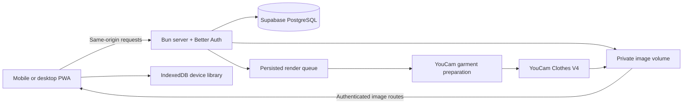

# PreSew

**Your photo. Your fabric. Your style. See it before you sew it.**

PreSew is a mobile-first fashion studio for people planning a custom-made outfit. Bring a photo of yourself, the fabric you want to use, and a style you love. Preview the combination on your own photo before committing to the first cut, then keep the outfit idea and optional measurements together for the next conversation with your tailor.

Built with TypeScript, Bun, Better Auth, Supabase PostgreSQL, and the YouCam API for the **YouCam API Skin AI & eCommerce VTO Hackathon**.

**Status:** functional local application; the builder has tested uploads and live try-ons. Production hosting and the public demo-video link are being prepared. A live deployment URL and final video URL have not yet been added to this README.

[How it works](#how-it-works) · [YouCam integration](#how-youcam-powers-the-preview) · [Run locally](#run-locally) · [Deploy](#deployment-flyio-or-vercel) · [Demo and submission](#hackathon-demo-and-submission) · [Design notes](DESIGN.md)

## Why PreSew exists

For a custom outfit, the usual order is expensive: buy fabric, pick a reference, explain it to a tailor, and find out how it looks after the fabric has already been cut.

An Ankara print may look very different on a flowing dress than on a fitted blouse. A screenshot of someone else's outfit does not show what your chosen fabric might look like on you. The cost of misunderstanding is paid in material, time, and alterations.

PreSew moves the visual conversation earlier. It is designed for event attendees planning an owambe look, everyday custom-clothing buyers, and designers helping a consenting client decide what to make. The goal is a more concrete decision before sewing, rather than a promise that an AI picture proves physical fit.

## A look inside


*The studio uses credited reference photography from Pexels. This screenshot shows the interface, not evidence of AI image quality.*

<details>
<summary>See the mobile studio</summary>


</details>


*The fitting-room screenshot uses catalog imagery as a UI fixture. The final demo should show an approved, real YouCam result and its original inputs.*

## How it works

1. **Start with a photo.** Sign in with Google and upload a clear photo of yourself or a person who has agreed to its use. Framing guidance helps you choose a suitable image.
2. **Choose the fabric.** Upload a well-lit fabric image or select a catalog reference. Keep it in your library for another outfit.
3. **Choose the silhouette.** Browse the style collection or upload a supported photo of a finished outfit. Use the same fabric with different styles.
4. **Review the combination.** Check the original photo, fabric, and style. Add optional notes and a measurement profile. Save an outfit plan or deliberately request a try-on after processing consent.
5. **Let the server create the look.** The render job and provider task IDs are saved. You can leave the screen and return to its status in **My looks**.
6. **Look closer.** Open a completed preview in the fitting room. Switch to the original photo, zoom, pan, inspect a subtle perspective view, or download the result.

## What is implemented

| Capability | Current behavior |
| --- | --- |
| Original photos | JPG/PNG validation, permission confirmation, reusable photo selection |
| Fabric and style libraries | Personal uploads, photographic catalog references, search, filters, favorites and source credits |
| Account access | Google sign-in through Better Auth; profile photo with initials fallback |
| Account storage | PostgreSQL library state; private disk image files with ownership checks |
| Real try-on | A two-stage YouCam preparation and Clothes V4 pipeline |
| Durable job handling | Persisted phases, provider task IDs, idempotency keys, worker leases, per-user cache and daily quotas |
| Interactive fitting room | Original/result switching, 100–400% zoom, drag/pan, touch-pinch support, keyboard controls and bounded image tilt |
| My looks | Completed and pending try-ons, saved outfit plans, search and separate filters |
| Optional measurements | Manual profiles, cm/in display, centimeter storage and validation |
| Outfit-plan export | Downloadable HTML containing references, notes and optional measurements; print it to PDF in a browser |
| PWA | Install manifest, public-shell caching, local fonts, safe update prompt, Android/iPhone installation guidance and platform-specific icons |

The fitting room uses one rendered image. **Perspective is not a true 360-degree model.** Back/side generation, model reconstruction, automatic measurements, yardage estimation, agent-written fit advice, group/aso ebi mode and dedicated generated-image/PDF sewing briefs are not implemented. See [DESIGN.md](DESIGN.md) for the path toward true 360 viewing.

## How YouCam powers the preview

The integration is server-side. The browser never receives the provider API key.

| Stage | API used by this code | Purpose |
| --- | --- | --- |
| Upload | `POST /s2s/v2.0/file`, then the returned signed PUT request | Upload the selected references and original person photo |
| Prepare garment | `POST /s2s/v2.0/task/image-to-image/youcam`, model `youcam-image-v2` | Use the style and fabric images together to prepare a garment reference |
| Try on | `POST /s2s/v2.0/task/cloth-v4` | Apply the prepared garment to the original person photo |
| Poll | GET the task endpoint with its saved task ID | Advance preparation/rendering without starting another paid task |
| Store result | Provider result download into private application storage | Retain a result the signed-in owner can reopen |

The preparation instruction asks the model to retain the style's silhouette, neckline, sleeves, seams and hem while applying the fabric's colors and motifs. The try-on request uses the **original person upload**, disables shoe changes, and requests strict person filtering. These are input constraints, not guarantees of perfect identity or print preservation.

Implementation: [provider client](server/youcam.ts), [job state machine](server/jobs.ts), [private images](server/images.ts), and [API routes](server/router.ts). Official reference: [YouCam Clothes V4](https://docs.perfectcorp.com/reference/ai_clothes/v4.0/paths/~1s2s~1v2.0~1task~1cloth-v4/post).

### Reliability and API-unit care

- Explicit consent and a deliberate **Try it on** action precede a submission.
- Repeated requests use an idempotency key; matching active/successful results can be reused per user.
- Atomic daily quota slots bound new render jobs. The default is five per user per day, configurable on the server.
- SQL stores task IDs and progress. A page refresh does not own or restart a provider task.
- Worker leases coordinate advancement. An uncertain paid submission is held for review rather than blindly repeated.
- Poll failures can be retried without making another paid generation request.

The two-stage workflow consumes provider units. Live image quality and latency depend on inputs, provider behavior and account access. Do not use an edited wait in a video as a measured performance claim.

## Architecture



| Layer | Actual implementation |
| --- | --- |
| UI | Browser TypeScript, semantic HTML and responsive CSS; bundled by Bun |
| API and worker | Bun HTTP server and a periodic render worker |
| Authentication | Better Auth with Google OAuth; optional Better Auth Infrastructure dashboard |
| Database | Supabase-hosted PostgreSQL; Bun SQL for app queries and `pg` for Better Auth |
| Private files | Disk storage under `PRIVATE_STORAGE_PATH`; a persistent volume in production |
| Local state | IndexedDB; device-to-account import is explicit |
| Styling | Warm ivory, dark ink and oxblood; self-hosted Manrope and Cormorant Garamond |

The current implementation is not a Next.js/Elysia/MongoDB scaffold. Earlier product planning may mention that stack; the source above describes what runs now.

## Run locally

### Prerequisites

- Bun 1.4+; the included container pins Bun 1.4.2.
- A Supabase PostgreSQL connection URI.
- A Google OAuth **Web application** client.
- A YouCam API key with access to both preparation and Clothes V4, plus available units.

From this directory:

```powershell
bun install --frozen-lockfile
if (-not (Test-Path .env)) { Copy-Item .env.example .env }
```

Fill `.env` privately. Keep the generated/existing auth secret; do not paste secrets into source, screenshots or chat.

| Variable | Meaning |
| --- | --- |
| `DATABASE_URL` | Required PostgreSQL URI from Supabase → Connect |
| `BETTER_AUTH_SECRET` | At least 32 random characters; keep stable across deployments using the same database |
| `GOOGLE_CLIENT_ID`, `GOOGLE_CLIENT_SECRET` | Server-side Google OAuth credentials |
| `YOUCAM_API_KEY` | Server-side YouCam credential |
| `BETTER_AUTH_URL` | Exact origin users open, including scheme and port |
| `PORT`, `HOST` | Local listener; use `HOST=0.0.0.0` inside the production container |
| `PRIVATE_STORAGE_PATH` | Local private file directory; `/data/assets` on the configured Fly volume |
| `MAX_RENDERS_PER_DAY` | New-job quota, default `5` |
| `BETTER_AUTH_API_KEY` | Optional Better Auth Infrastructure integration |
| `BETTER_AUTH_TRUSTED_ORIGINS` | Optional comma-separated additional exact trusted origins |

For port 3000, register `http://localhost:3000/api/auth/callback/google` as a Google redirect URI and set `BETTER_AUTH_URL=http://localhost:3000`. The sample `.env` uses an IPv6 loopback listener; select a host reachable by your browser if needed. Production must use HTTPS.

```powershell
bun run setup:check
bun run db:migrate
bun run dev
```

The dev command builds once, then starts the API and worker. **Restart after source edits.** If a previous PWA shell is cached, accept the in-app **Refresh app** update.

The database must be PostgreSQL for real startup. SQLite is restricted to isolated automated tests. App tables live in `presew`; Better Auth tables live in `presew_auth`. Keep both schemas unexposed in Supabase's Data API. Migrations enable RLS and revoke client-role access; the backend needs an appropriate database role. See [SETUP.md](SETUP.md) for connection and OAuth details.

### Commands

| Command | Result |
| --- | --- |
| `bun run dev` | Build once and serve the app/API/worker |
| `bun run build` | Generate brand assets and bundle the frontend into `dist/` |
| `bun run start` | Serve an existing build with the configured database and worker |
| `bun test` | Domain, private API, render-state and preview-math tests |
| `bun run pwa:check` | Validate built manifest icons, dimensions, mask safe areas, Apple/favicon files and cache references; run after build |
| `bun run setup:check` | Show configured/missing flags without printing secret values |
| `bun run db:migrate` | Apply application and configured Better Auth schema migrations |

No lint or standalone type-check script is configured. A successful Bun build is not a claim that TypeScript's standalone checker ran.

## PWA and app icons


| Surface | Asset |
| --- | --- |
| Android/desktop installation | `app-icon-192.png`, `app-icon-512.png` with manifest purpose `any` |
| Android adaptive masks | Separate `maskable-icon-192.png` and `maskable-icon-512.png`; full-bleed background and safe-area artwork |
| iPhone/iPad home screen | `apple-touch-icon.png`, 180 × 180 |
| Browser tabs | Vector `icon.svg`, 32px PNG fallback and `favicon.ico` |

All platform icons are generated from one rounded P monogram in [create-assets.ts](scripts/create-assets.ts). The previous star motif is removed. Brand colors and the wordmark remain consistent with the in-app header. The manifest identity stays `/`, preserving the application's identity across updates.

Android browsers may offer **Install PreSew**. On iPhone Safari, use **Share → Add to Home Screen**. Already-installed launcher icons may remain cached by the operating system; verify a new installation when checking the revised icons.

The service worker caches only the public shell, brand assets and local fonts. Device drafts can remain available offline. Account APIs, private photos, external catalog photos, authentication and live try-on require connectivity and are not made offline by the shell cache.

## Deployment: Fly.io or Vercel?

**Use Fly.io for the current application.** This is an architectural recommendation: the app already has a Docker build, one same-origin server, a continuously advancing worker and private disk images.

| Concern | Fly.io with the included configuration | Moving the current app to Vercel |
| --- | --- | --- |
| Bun server | Run the existing container | Bun is supported, but a Vercel entrypoint/configuration is needed |
| Render processing | Keep the Machine running for the existing worker | Replace the process timer with a suitable durable worker/workflow setup |
| Private image files | Mount `/data` as persistent storage | Move uploads/results to durable object storage |
| Uploads | Current server accepts larger image/library requests | Redesign around direct uploads rather than exceeding Function payload limits |
| Authentication | Frontend and API remain on one origin | Keep one origin or carefully configure proxy, cookies and trusted origins |
| Work before the hackathon | Configure and validate the existing packaging | Additional storage, lifecycle and request-path work |

[Vercel supports Bun Functions](https://vercel.com/docs/functions/runtimes/bun), so Bun itself is not the obstacle. Its documented [Function payload limit](https://vercel.com/docs/functions/limitations#request-body-size) matters to this image workflow. [Fly Volumes](https://fly.io/docs/volumes/overview/) fit the current disk adapter, although one Machine/volume is not a high-availability design.

Follow [DEPLOY.md](DEPLOY.md) for exact commands. Replace the placeholder app name and production auth URL in `fly.toml`; set server secrets; add the final Google callback URI; migrate any existing private files; and deploy with one Machine. Do not import a local tunnel `.env` wholesale into production.

Existing images are **not** stored inside Supabase image storage. If production reuses the current database, transfer local private files to the Fly volume while preserving filenames. Retain backups. Move to shared object storage before horizontal scaling; separate Machines do not automatically share a volume's contents.

`GET /api/health` checks database connectivity plus initialized authentication and render processing. A healthy response does not prove Google callbacks or YouCam account permissions work: complete the live checks before sharing the URL.

## Hackathon demo and submission

PreSew targets the fashion/eCommerce VTO direction of the [YouCam hackathon](https://youcam-api-skin-ai-ecommerce.devpost.com/). The specific value is helping custom-clothing buyers evaluate their own fabric/style decision before sewing. Clothes V4 is the qualifying fashion integration; garment preparation is an additional implemented step. Skin analysis and makeup are not claimed features.

The [official rules](https://youcam-api-skin-ai-ecommerce.devpost.com/rules) require a working YouCam-integrated project, code access, a description and an end-to-end 1–3 minute video. The overview also asks for screenshots. This repository supplies setup, implementation explanations and UI images; real result evidence and reviewer access must be completed in the final submission.

Submission cutoff shown on October 22, 2026: **November 2, 2026, 11:45 a.m. EST / 5:45 p.m. WAT in Lagos.** Aim to submit November 1. Verify the live event page again before submitting.

For the video, show a real mobile workflow: original photo → fabric → style → consent → provider processing → completed result → original comparison → saved look. Identify the two YouCam stages. Label shortened waiting and use approved people/assets. Do not present the catalog fixture screenshots above as actual AI results, or image tilt as a 360 reconstruction.

Before submission, add the deployed app URL and publicly viewable video URL near the top of this README, confirm repository access/licensing, and provide practical judging instructions. Make sure the Google OAuth audience/test-user configuration lets reviewers sign in and that the account has enough provider units for evaluation. Never publish private credentials or provider keys in the README.

## Privacy and limitations

- Images are sent to YouCam only after the user requests a try-on and gives processing consent. Private application image routes check ownership and return `private, no-store` responses.
- Device libraries belong to a browser origin. Import them into the signed-in account explicitly before changing domains if you want them carried across.
- Removing a library item does not necessarily remove snapshots retained by saved plans or jobs. Users can delete individual try-ons directly from the fitting room, detail dialog, or history cards, which permanently deletes the try-on record and purges unshared output image assets from server storage. The account's cloud-data deletion action removes server studio records and files after active jobs finish.
- Provider-retained copies and downloaded files are separate. Immediate provider-side deletion and automatic application asset expiry are not implemented. Review the provider's current retention policy for your account before production use.
- Measurements are entered manually, stored in centimeters, and used in outfit plans. They do not drive the try-on image or establish tailor-grade accuracy.
- An AI preview can change face/body details, fabric motifs, seams or construction. Compare it with the inputs and confirm physical details with a tailor.

## Validation

The automated suite currently has **25 passing tests** covering measurement boundaries, independent plan snapshots, ownership and origin checks, stale-write conflicts, private image normalization, idempotency/cache/quota behavior, individual try-on deletion with asset cleanup, mocked provider progression/recovery, readiness and preview zoom/pan math.

Production frontend and local Docker builds have passed. The static PWA checker verifies icon sizes and mask-safe artwork. Browser QA used isolated account fixtures for layouts, filters, original comparison, keyboard controls and PWA updates. The builder has separately tested real uploads and try-ons. Physical-phone gestures, newly installed launcher icons, production OAuth, storage migration and live deployment remain launch checks.

Tests do not consume live YouCam units. Screenshots and browser fixtures do not establish live API realism or promise a particular latency.

## Source map

```text
src/                 Browser screens, shared domain logic, IndexedDB and API client
  app.ts             Navigation, libraries, creation, account and history UI
  preview.ts         Interactive fitting-room page and input handling
  preview-state.ts   Pure zoom/pan/pinch calculations
server/              Auth, private images, database, API and render worker
  youcam.ts          File/preparation/Clothes V4 provider client
  jobs.ts            Persistent render state machine, quotas and recovery
public/              Styles, manifest, service worker, catalog assets and local fonts
scripts/             Build, asset generation, setup and PWA checks
docs/images/         README screenshots and brand banner
DESIGN.md            Visual direction and honest 360-preview scope
SETUP.md             Provider/database configuration
DEPLOY.md            Fly.io launch and migration checklist
```

## Credits and licensing

Catalog photography is sourced from Pexels; individual source/photographer credits are stored in [catalog.ts](src/catalog.ts) and shown in the app. Cormorant Garamond and Manrope are distributed under the SIL Open Font License; their license files are included in `public/fonts/`. Brand assets are code/vector artwork generated for PreSew. Respect the terms of every provider and dependency used by the project.

A project-wide source license has not yet been selected. Add an appropriate license before making a public submission, or use the organizer-approved private repository sharing process. Do not imply that the third-party fonts, photographs, YouCam services or dependencies are covered by a future project source license.
